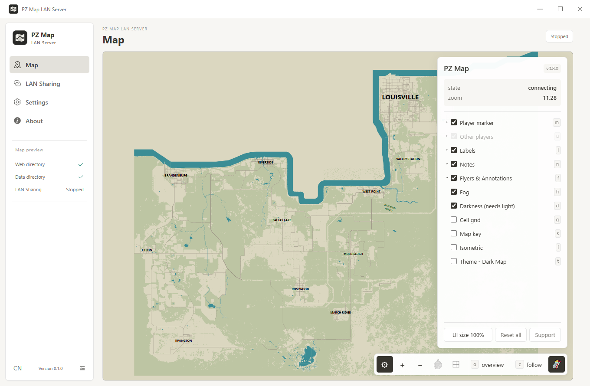
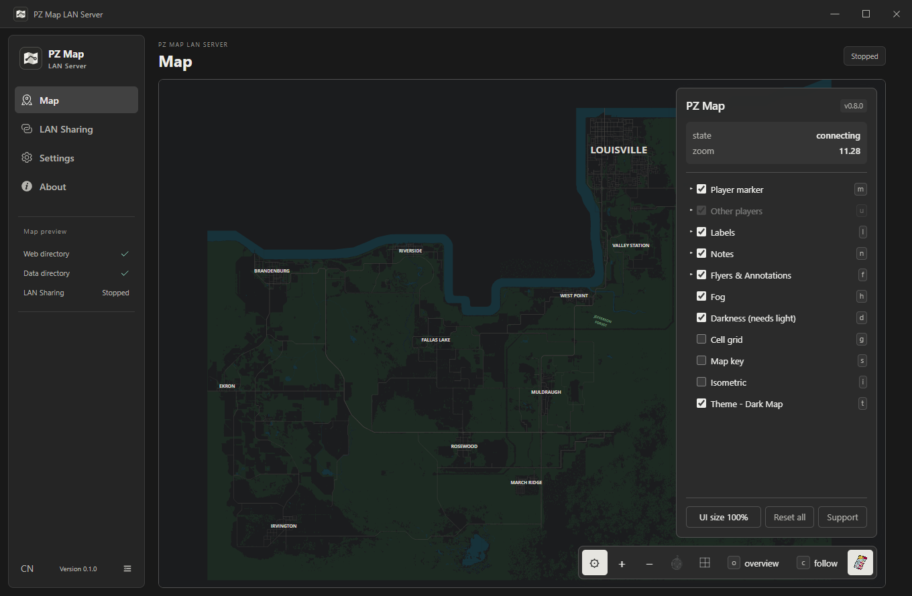
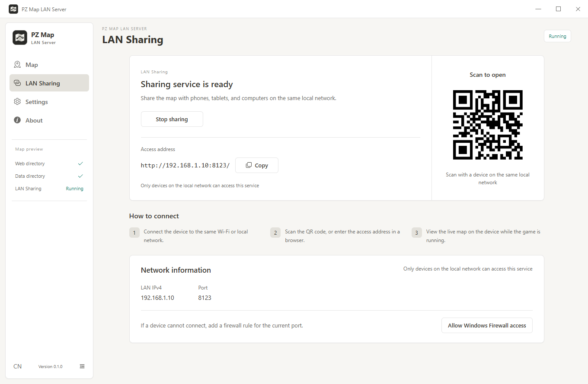

# PZ Map LAN Server

[中文](README.md) | English

Turn a phone, tablet, or another computer into a live Project Zomboid map display. Share the **PZ Map** mod's web map over your local network and keep it visible on another screen while playing fullscreen on your PC.

## Why this tool exists

The game already has a map and a minimap, but opening the full map to check your position or route still takes your attention away from play. In multiplayer, opening the map does not pause time: your character can still be in danger while you look.

Keeping the map on a device beside you reduces the need to repeatedly open and close the in-game map. It gives players with a single monitor a separate screen for the full map, ready for a glance while the game continues running.

This app provides a local preview, an HTTP server, and interface adaptations. Map geometry, player positions, fog, and notes come from the PZ Map mod.

Future work may add more tools to this independent interface, such as waypoints and route planning. These are possible future additions, not currently available features. Extensions will operate within this companion app without modifying game or mod content.

## Screenshots

Screenshots show the current interface. The map is an offline preview, and the sharing page uses an example LAN address.

### Light map interface



### Dark map interface

Neutral charcoal panels remain distinct from the map's own dark palette.



### LAN sharing



## Features

- Automatically finds map files in Steam libraries, with manual directory selection and validation.
- Live preview inside the app, independent of LAN sharing.
- Start / stop sharing, copy the access address, or scan a QR code.
- Touch dragging and pinch zoom for the map, with scrollable settings panels.
- Chinese / English and Light / Dark / System appearance.
- Map panels follow the app's language and appearance; connected browsers receive updates without reloading.
- On first use, fog and settings are closed, the legend is shown, and player follow engages when the game connects. Later panel choices are remembered; server-enforced rules take priority.
- Configurable port and a Windows Firewall rule shortcut.

Panel styling and translations are injected into HTTP responses at runtime. **Original mod files are never modified.** Diagnostic logs, map place names, and player notes retain their original content. New panel text introduced by future mod updates may need additional translations.

## Requirements

- Windows 10 / 11, 64-bit.
- Steam Project Zomboid Build 42 with [PZ Map](https://steamcommunity.com/sharedfiles/filedetails/?id=3770149036) subscribed and enabled.
- The PC and viewing devices connected to the same local network.

PZ Map's Workshop ID is **3770149036**, and its Mod ID is `PZ_Map`. Current panel adaptations were checked against PZ Map 0.8.0.

Game and mod files are not included. Load a save with the mod enabled at least once before setup so it can create its data files.

## Installation and setup

Choose a Windows x64 download from this repository's Releases page:

| File | Purpose |
| --- | --- |
| `PZ-Map-LAN-Server-<version>-x64-Setup.exe` | Installer with a selectable installation directory |
| `PZ-Map-LAN-Server-<version>-x64-Portable.zip` | Extract and run without installing |

Extract the entire ZIP into a folder, then run `PZ Map LAN Server.exe` inside it. Do not extract only the EXE. Preferences are still stored in the Windows user configuration directory and do not travel with the application folder.

Open **Settings** and confirm both directories.

**Web directory:** if automatic detection fails, browse to the `web` folder containing `index.html`:

```text
<SteamLibrary>\steamapps\workshop\content\108600\3770149036\mods\PZ_Map\42\media\web
```

**Data directory:** select the folder containing `heartbeat.txt`. The default is:

```text
%USERPROFILE%\Zomboid\Lua\PZ_Map
```

If you relocated the game's user directory, select the corresponding data folder there. Once both directories are valid, the map preview is available. Browsing for folders saves automatically; click **Save settings** after typing paths or changing the port manually.

## Using a phone or tablet

1. Load a game save and keep both the game and this app running.
2. Open **LAN Sharing** and click **Start sharing**. The default port is `8123`.
3. On another device on the same network, scan the QR code or open the displayed address, such as `http://192.168.1.10:8123/`.
4. Drag with one finger and pinch to zoom the map. The gear button opens map settings.

Stopping sharing disconnects other devices from live data; the local preview runs independently. Exiting the app stops all services. Restart sharing after changing the port.

Language and appearance changes in **Settings → Interface** save automatically. Light / Dark applies the selected theme to shared pages. System lets each viewing device follow its own system color preference.

## Troubleshooting

**Invalid directories:** the web directory must contain `index.html`, and the data directory must contain `heartbeat.txt`. Check the selected folders and load a save with PZ Map enabled.

**Map loads but position does not update:** check that the game is running, the mod is enabled for the current save, and the correct data directory is selected. The app cannot generate live positions when the game stops exporting data.

**Another device cannot connect:** use the PC's LAN IPv4 address, not `localhost` or `127.0.0.1`. Guest Wi-Fi, AP isolation, VPNs, and virtual adapters can affect access. With multiple adapters, you may need to replace the automatically selected address with the IPv4 address of your actual Wi-Fi or Ethernet adapter.

**Firewall blocks access:** **Allow Windows Firewall access** requests administrator permission to add an inbound rule for the current TCP port, restricted to `LocalSubnet`. Use a trusted network. After uninstalling or switching ports, remove unused `PZ Map LAN Server <port>` rules through **Windows Defender Firewall with Advanced Security → Inbound Rules**.

**Port already in use:** choose another available port between `1024` and `65535`, then start sharing again.

**Unknown publisher / SmartScreen:** current builds are unsigned. Verify the download source and SHA256 checksum supplied with the release before using the options Windows offers to run it.

## Access and data

The server accepts GET / HEAD requests only and restricts access to loopback and IPv4 subnets attached to the host. The selected web and data directories are served at `/app/` and `/data/`; live data responses disable browser caching.

The server uses HTTP without login authentication. Allowed local devices can read files in the selected directories. Select only the mod's web and map data folders, not personal document folders. Do not configure public port forwarding. The app does not provide cloud synchronization.

## Run from source

Use Windows with Node.js 22 or a newer compatible LTS release and npm. Dependency installation and the first packaging run require internet access to download build components.

```powershell
npm ci
npm run dev
```

If PowerShell asks how to open `npm` or blocks the script, try `npm.cmd ci` and `npm.cmd run dev`, then check your Node.js installation and PATH.

For an `EPERM` error in the npm cache directory, use a writable cache:

```powershell
npm.cmd ci --cache "$env:TEMP\pz-map-npm-cache"
```

If startup reports `Electron uninstall`, ensure installation scripts were not disabled and run `npm.cmd rebuild electron` to install the Electron runtime.

## Checks and packaging

```powershell
npm run lint
npm run build
npm run dist
```

`dist` builds a Windows x64 NSIS installer and a portable ZIP archive in `release/`. It does not upload or publish them. `release/win-unpacked/` is available for local inspection and need not be published separately.

Before publishing, test the installer and extracted ZIP application: launch, directory selection, persisted theme and language, and access from a real LAN device. Upload Setup.exe, Portable.zip, and their SHA256 checksum file to a GitHub Release manually. Match the version tag to `package.json`, for example `v0.1.0`.

Source layout:

```text
src/                    Vue interface, translations, and app themes
electron/main/          Window, discovery, HTTP server, firewall, map adaptations
electron/preload/       Desktop IPC bridge
assets/                 App interface assets
electron-builder.yml    Windows packaging configuration
```

## Credits and license

Thanks to the **original PZ Map author and contributors** for the map renderer and game data export. Author details, updates, and usage instructions are available on the [PZ Map Workshop page](https://steamcommunity.com/sharedfiles/filedetails/?id=3770149036) (Workshop ID: 3770149036). This is an independent companion tool, not an official game or mod project, and it does not redistribute their assets.

App author: [TiiJeiJ8](https://github.com/TiiJeiJ8). Source code is released under the [MIT License](LICENSE). Games, mods, and third-party dependencies retain their respective rights and licenses.
