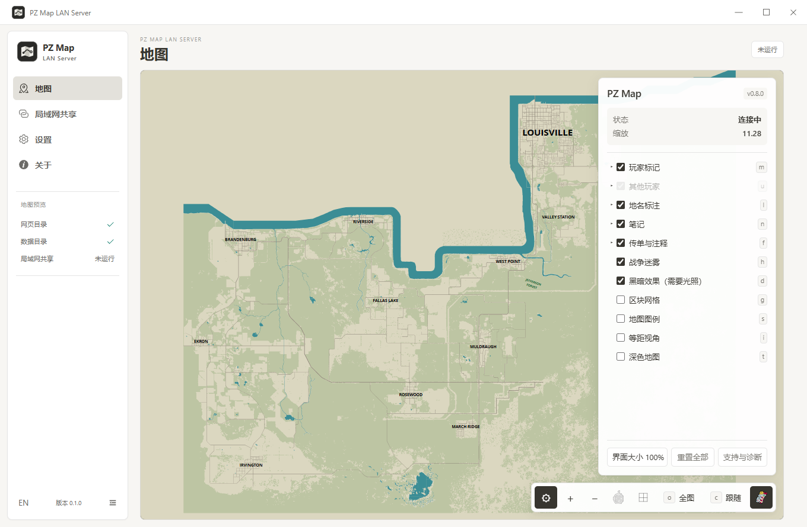
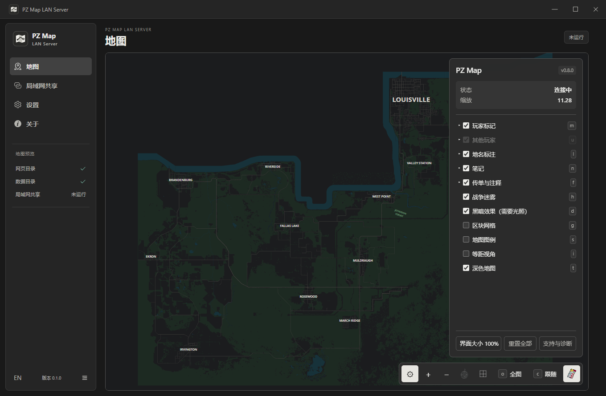
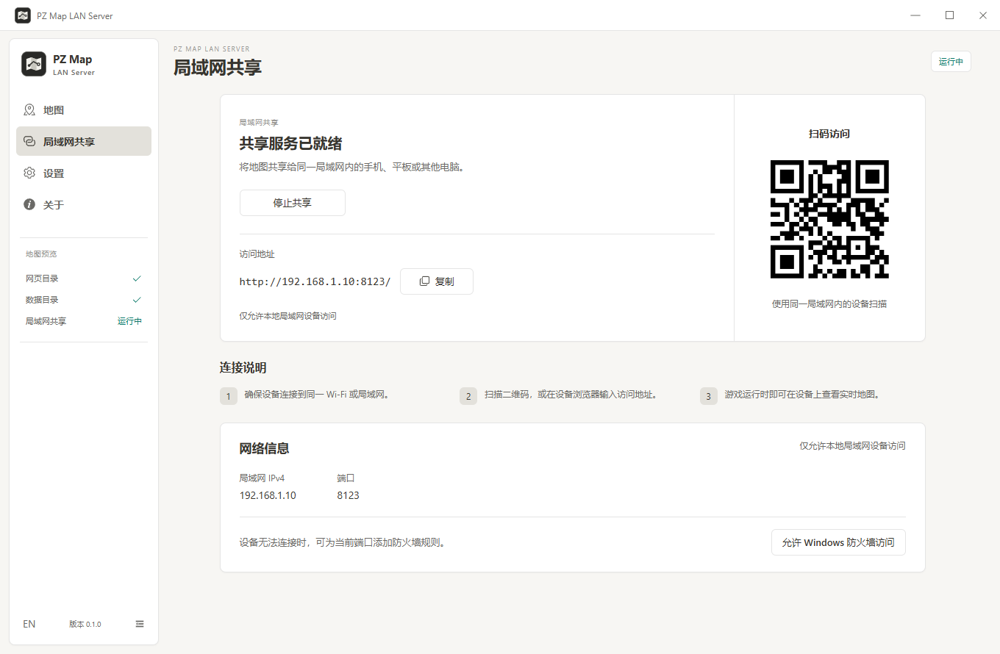

<p align="center">
  
</p>

<h1 align="center">PZ Map LAN Server</h1>

<p align="center">
  <a href="https://github.com/TiiJeiJ8/PZ-Map-LAN-Server/releases/latest"></a>
  <a href="https://github.com/TiiJeiJ8/PZ-Map-LAN-Server/releases"></a>
  <a href="https://github.com/TiiJeiJ8/PZ-Map-LAN-Server/blob/main/LICENSE"></a>
</p>

<p align="center">中文 | <a href="README-en.md">English</a></p>

让手机、平板或另一台电脑成为 Project Zomboid 的实时地图屏幕。通过局域网共享 **PZ Map** 模组地图网页，在 PC 上全屏游玩时，抬眼就能查看另一块屏幕上的地图。

## 为什么做这个工具

游戏原本就有地图和小地图，但打开大地图查看位置、确认路线仍需要切换注意力。在多人游戏中，打开地图也不会暂停时间，查看地图的这段时间里，角色仍可能遇到危险。

这个工具让地图持续显示在手边的另一台设备上，减少反复打开、关闭游戏内大地图的操作，也为只有一台显示器的玩家提供一个查看完整地图的独立屏幕。游戏仍照常运行，你可以随时看一眼地图，再继续操作角色。

本应用负责本机预览、局域网服务和界面适配。地图、玩家位置、迷雾及笔记数据来自 PZ Map 模组。

后续会考虑在这个独立界面中扩展更多辅助功能，例如路径点与路线规划；这些属于未来方向，目前尚未实现。扩展只作用于本工具，不修改游戏或模组内容。

## 界面预览

以下为当前版本界面截图。地图为未连接游戏的预览；共享页使用示例局域网地址。

### 浅色地图界面



### 深色地图界面

应用面板使用中性炭灰色，与地图自身的深色配色保持区分。



### 局域网共享



## 功能

- **独立地图屏幕**：在应用内实时查看地图，也可共享到手机、平板或另一台电脑。
- **局域网实时共享**：通过浏览器地址或二维码访问游戏地图与玩家位置，支持触屏拖动和双指缩放。
- **独立辅助工具**：地图数据由 PZ Map 提供；本应用仅适配显示和传输，不修改游戏或模组文件。

地图面板的样式与翻译在页面响应中临时注入，**不会修改模组原始文件**。诊断日志和地图上的原始地名、玩家笔记不翻译。模组更新后新增的面板文案可能需要后续适配。

## 使用前准备

- Windows 10 / 11，64 位。
- Steam 版 Project Zomboid Build 42，已订阅并启用 [PZ Map](https://steamcommunity.com/sharedfiles/filedetails/?id=3770149036)。
- 电脑与查看地图的设备处于同一局域网。

PZ Map 的 Workshop ID 为 **3770149036**，Mod ID 为 `PZ_Map`。当前地图面板适配基于 PZ Map 0.8.0。

本应用不包含游戏或模组文件。首次配置前，请进入一次启用了模组的游戏存档，让模组生成数据文件。

## 安装与配置

在本仓库的 Releases 页面选择一种 Windows x64 版本：

| 文件 | 用途 |
| --- | --- |
| `PZ-Map-LAN-Server-<版本>-x64-Setup.exe` | 安装版，可选择安装目录 |
| `PZ-Map-LAN-Server-<版本>-x64-Portable.zip` | 解压后运行，无需安装 |

ZIP 解压版请完整解压到一个文件夹，再运行其中的 `PZ Map LAN Server.exe`，不要仅提取 EXE。设置仍保存到 Windows 用户配置目录，不会随程序文件夹一起移动。

打开应用后，在“设置”中确认两个目录：

**网页目录**：自动查找失败时，点击“浏览…”选择包含 `index.html` 的 `web` 文件夹。

```text
<SteamLibrary>\steamapps\workshop\content\108600\3770149036\mods\PZ_Map\42\media\web
```

**数据目录**：选择包含 `heartbeat.txt` 的文件夹，默认位置为：

```text
%USERPROFILE%\Zomboid\Lua\PZ_Map
```

如果迁移了游戏用户目录，请选择迁移后的对应数据目录。目录均显示有效后即可预览地图。浏览选择会自动保存；手动输入目录或修改端口后，点击“保存设置”。

## 在手机或平板上使用

1. 进入游戏存档，保持游戏和本应用运行。
2. 打开“局域网共享”，点击“启动共享”。默认端口为 `8123`。
3. 在同一局域网设备上扫描二维码，或用浏览器打开显示的地址，例如 `http://192.168.1.10:8123/`。
4. 单指拖动地图，双指缩放地图。底部齿轮打开地图设置。

停止共享后，其他设备无法继续获取数据；本机地图预览独立运行。退出应用会停止所有服务。在设置中选择“驻留系统托盘”后，关闭窗口会继续共享，可从托盘菜单退出。修改目录或端口后，需要重新启动共享。

切换到其他页面时，本机地图暂停绘制；最小化或隐藏窗口超过 60 秒后，会释放本机地图资源，下次进入地图页恢复视角和设置。局域网共享继续运行。此优化需要兼容的地图版本，无法安全恢复时会保留预览。

共享页每 3 秒刷新状态。“最后数据更新”是模组心跳文件的修改时间；“最近连接设备”统计最近 60 秒成功读取数据的远程 IP，同一 IP 合并计数，不代表持续在线。应用能显示本机可确认的错误及排查建议，不能直接判断远端设备被 Wi-Fi 隔离等原因。

在“设置 → 界面”切换语言与外观，选择会自动保存。固定浅色 / 深色时，共享网页使用相同主题；“跟随系统”让各访问设备使用自己的系统配色。

## 连接问题

**目录校验失败**：网页目录需要 `index.html`，数据目录需要 `heartbeat.txt`。确认选择的是对应文件夹，并已进入启用 PZ Map 的存档。

**地图显示但位置不更新**：确认游戏仍在运行、当前存档启用了模组，并检查数据目录是否正确。游戏退出或暂停导出后，应用无法自行产生实时位置。

**其他设备打不开地址**：确认使用的是电脑的局域网 IPv4 地址，而非 `localhost` 或 `127.0.0.1`。访客 Wi-Fi、AP 隔离、VPN 或虚拟网卡可能影响访问；存在多个网卡时，自动选择的地址可能需要改为实际 Wi-Fi / 有线网卡的 IPv4。

**防火墙阻止连接**：共享页提供“允许 Windows 防火墙访问”按钮，会请求管理员权限，为当前 TCP 端口添加仅允许 `LocalSubnet` 来源的入站规则。建议仅在可信家庭网络中使用。卸载或更换端口后，如不再使用旧规则，可在“高级安全 Windows Defender 防火墙 → 入站规则”中删除对应的 `PZ Map LAN Server <端口>` 规则。

**端口被占用**：在设置中换用 `1024–65535` 范围内的其他空闲端口，再启动共享。

**Windows 提示未知发布者 / SmartScreen**：当前构建没有代码签名。请核对下载来源与发布页的 SHA256 校验值；确认来源可信后，再通过系统提供的选项运行。

## 访问范围与数据

服务只接受 GET / HEAD 请求，仅向本机及本机网卡所在 IPv4 子网提供服务。选定的网页目录与数据目录分别映射为 `/app/` 和 `/data/`，实时数据禁止浏览器缓存。

服务使用 HTTP，没有登录认证。被允许的局域网设备可以读取选定目录中的文件；请只选择模组网页和地图数据目录，不要选择个人文档等其他目录。请勿配置公网端口转发。应用不提供云端同步服务。

## 从源码运行

需要 Windows、Node.js 22 或更新的兼容 LTS 版本，以及 npm。安装依赖及首次打包需要联网下载相关组件。

```powershell
npm ci
npm run dev
```

如果 PowerShell 对 `npm` 弹出“选择打开方式”或拦截脚本，可先使用 `npm.cmd ci`、`npm.cmd run dev`，并检查 Node.js 安装及 PATH 配置。

若 npm 缓存目录出现 `EPERM`，可临时使用当前用户可写的缓存：

```powershell
npm.cmd ci --cache "$env:TEMP\pz-map-npm-cache"
```

若启动时报 `Electron uninstall`，确认依赖安装未禁用安装脚本，并执行 `npm.cmd rebuild electron` 以补全 Electron 运行时。

## 检查与打包

```powershell
npm run lint
npm test
npm run build
npm run dist
```

`dist` 构建 Windows x64 NSIS 安装版和 ZIP 解压版，输出到 `release/`，不会自动上传或发布。`release/win-unpacked/` 用于本地检查，不必作为独立下载文件发布。

发布前请分别验证安装版和 ZIP 解压版的启动、目录选择、主题与语言保存，以及实际局域网设备访问。将 Setup.exe、Portable.zip 和对应的 SHA256 校验文件手动上传到 GitHub Release，并让版本标签与 `package.json` 一致，例如 `v0.1.27`。

主要源码目录：

```text
src/                    Vue 界面、语言资源与应用主题
electron/main/          窗口、路径发现、HTTP 服务、防火墙、地图适配
electron/preload/       桌面 IPC 接口
assets/                 应用自有界面资源
electron-builder.yml    Windows 打包配置
```

## 致谢与许可

感谢 **PZ Map 原作者及贡献者** 提供地图渲染与数据导出功能。模组的作者信息、更新和使用说明请见 [PZ Map 创意工坊页面](https://steamcommunity.com/sharedfiles/filedetails/?id=3770149036)（Workshop ID：3770149036）。本项目是独立的辅助工具，不代表游戏或模组官方，也不分发其资源。

应用作者：[TiiJeiJ8](https://github.com/TiiJeiJ8)。项目源码使用 [MIT License](LICENSE)；游戏、模组及第三方依赖的权利与许可证归各自作者所有。
